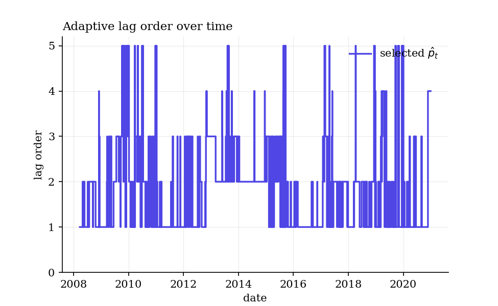
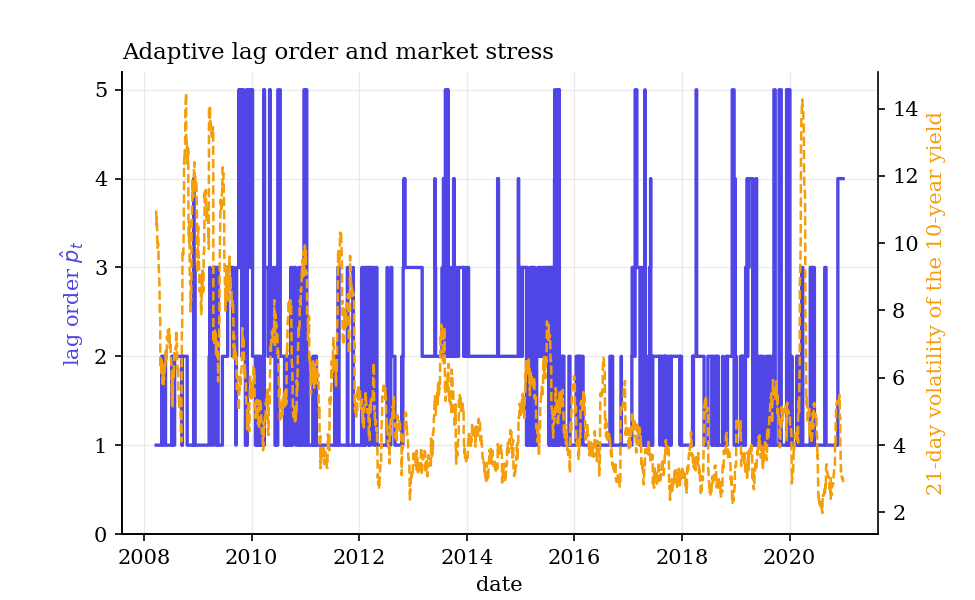
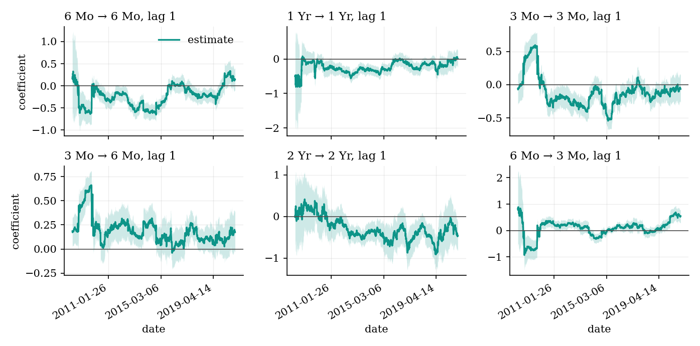
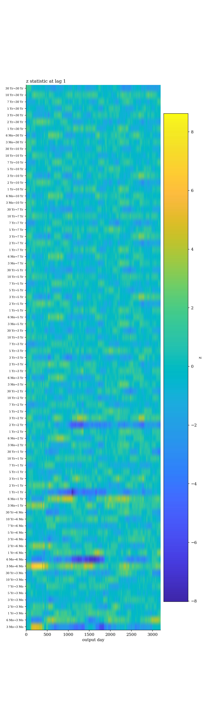
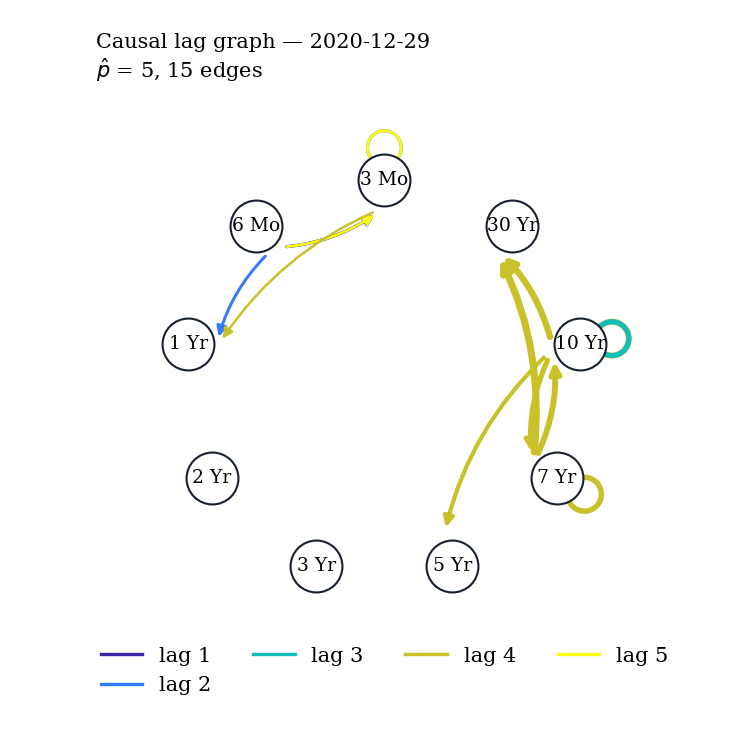

# oracle-varx

[](https://pypi.org/project/oracle-varx/)
[](https://pypi.org/project/oracle-varx/)
[](LICENSE)
[](https://merwanroudane.github.io/oracle-varx/)

**oracle-varx** implements **ORACLE-VARX** — the causal lag discovery method of
Tan, Zanoria, Chen, Lyu and Cucuringu (2026),
*Causal Lag Structure Discovery in Confounded Time Series via Orthogonalized
Adaptive Estimation* ([doi:10.48550/arXiv.2610.05618](https://doi.org/10.48550/arXiv.2610.05618)) —
in Python: it tells you **which series causes which, at what lag, and when**,
with a coefficient, a standard error, a confidence interval and a
false-discovery-rate guarantee for every edge.

```bash
pip install oracle-varx
```

| | |
|---|---|
| 📦 **PyPI** | <https://pypi.org/project/oracle-varx/> · [v0.1.1](https://pypi.org/project/oracle-varx/0.1.1/) |
| 💻 **Source** | <https://github.com/merwanroudane/oracle-varx> |
| 📖 **Documentation** | <https://merwanroudane.github.io/oracle-varx/> |
| 📐 **Method notes** | [docs/methods.md](docs/methods.md) |
| 📄 **The paper** | [doi:10.48550/arXiv.2610.05618](https://doi.org/10.48550/arXiv.2610.05618) |
| 📝 **Changelog** | [CHANGELOG.md](CHANGELOG.md) |
| 🐛 **Issues** | <https://github.com/merwanroudane/oracle-varx/issues> |
| 🧑‍💻 **Author** | Dr Merwan Roudane · merwanroudane920@gmail.com · [github.com/merwanroudane](https://github.com/merwanroudane) |

---

## Table of contents

1. [What this package does](#1-what-this-package-does)
2. [Start from absolutely nothing](#2-start-from-absolutely-nothing)
3. [Installation](#3-installation)
4. [Your first analysis in 60 seconds](#4-your-first-analysis-in-60-seconds)
5. [Complete example with real data](#5-complete-example-with-real-data)
6. [Full syntax reference](#6-full-syntax-reference)
7. [Interpreting the output](#7-interpreting-the-output)
8. [Using your own Excel or CSV file](#8-using-your-own-excel-or-csv-file)
9. [Exporting tables and figures](#9-exporting-tables-and-figures)
10. [The method](#10-the-method)
11. [What this package adds beyond the paper](#11-what-this-package-adds-beyond-the-paper)
12. [Practical guidance and pitfalls](#12-practical-guidance-and-pitfalls)
13. [Faithfulness to the paper](#13-faithfulness-to-the-paper)
14. [Limitations](#14-limitations)
15. [References, citation, author](#15-references-citation-author)

---

## 1. What this package does

You have several time series and you want to know what drives what. The classical
answer is a vector autoregression with Granger-causality tests, and it has three
weaknesses that matter in real data: confounders are assumed to enter linearly or
to be absent, the lag order is fixed once for the whole sample, and testing every
edge separately produces a pile of false discoveries.

ORACLE-VARX fixes all three in one pipeline, and this package implements it:

| Stage | What it does | Paper |
|---|---|---|
| **Double machine learning** | A flexible learner (trees, boosting, a tabular foundation model, anything scikit-learn-shaped) predicts both the outcomes and the lagged series from the confounders; the lag coefficients are then estimated on the **residuals**, so nonlinear confounding is removed without assuming its form | §3.2, eq. (4)–(8) |
| **Adaptive causal lag estimation (ACLE)** | In each rolling window, lags are added one at a time while they remain statistically significant, and the significance level itself is tuned on validation forecasts — so the lag order **changes over time** and tracks regime shifts | §3.3, eq. (9)–(10) |
| **FDR-controlled edge discovery** | A Benjamini–Hochberg step over all entry-wise tests in the window selects directed, lag-annotated edges at a target false discovery rate | §3.4, Appendix D.4 |

What you get out:

- a **causal lag graph** per period — `X → Y at lag 2`, with a coefficient and a q-value;
- a **confidence interval for every edge**, from the local asymptotic normality of
  Theorem 1;
- the **selected lag order over time**, which in financial data rises in stressed
  markets;
- **journal-ready tables** (text, LaTeX booktabs, Markdown) and **figures** in one
  consistent style, Parula by default;
- a **real shipped dataset** so everything here runs offline;
- the paper's full **method hierarchy** — six nested models — so you can attribute
  any result to the component that produced it.

## 2. Start from absolutely nothing

*Never used Python? Do these four steps once. Fifteen minutes.*

### Step 1 — install Python

Download **Anaconda** (recommended for researchers: Python, Jupyter and Spyder in
one installer) from <https://www.anaconda.com/download>, or plain Python from
<https://www.python.org/downloads/>. On the python.org installer, **tick "Add
Python to PATH"** on the first screen.

### Step 2 — open a terminal

- **Windows:** press `Win`, type `Anaconda Prompt` (or `cmd`), press Enter.
- **macOS:** press `Cmd+Space`, type `Terminal`, press Enter.

Check it works — type this and press Enter:

```bash
python --version
```

You should see something like `Python 3.11.5`.

### Step 3 — install this package

```bash
pip install oracle-varx
```

### Step 4 — run your first command

Type `python`, press Enter, then paste:

```python
import oracle_varx
print(oracle_varx.__version__)
```

Type `exit()` to leave.

### Where do I write my code?

| Tool | Best for | How to open |
|---|---|---|
| **Jupyter Notebook** | step-by-step work with figures inline | type `jupyter notebook` |
| **Spyder** | a MATLAB/RStudio-like window | type `spyder`, or use Anaconda Navigator |
| **A `.py` file** | a reproducible script | save `analysis.py`, then run `python analysis.py` |

## 3. Installation

```bash
pip install oracle-varx                  # core
pip install "oracle-varx[boost]"         # + LightGBM and XGBoost first stages
pip install "oracle-varx[plotly]"        # + interactive 3-D surfaces
pip install "oracle-varx[data]"          # + yfinance, for the sector-ETF example
pip install "oracle-varx[robust]"        # + arch, for block-bootstrap inference
pip install "oracle-varx[baselines]"     # + tigramite and lingam, for comparisons
pip install "oracle-varx[all]"           # everything above
```

Development version:

```bash
pip install git+https://github.com/merwanroudane/oracle-varx.git
```

Requirements: Python ≥ 3.10 with `numpy`, `scipy`, `pandas`, `scikit-learn`,
`statsmodels`, `matplotlib` and `joblib`, all installed automatically. The package
name has a hyphen (`pip install oracle-varx`); the import name has an underscore
(`import oracle_varx`).

## 4. Your first analysis in 60 seconds

```python
import numpy as np
from oracle_varx import oracle_varx
from oracle_varx.datasets import make_oracle_dgp

# Three series in a lag-1 causal cycle, with nonlinear confounding
Y, W, truth = make_oracle_dgp(n_obs=600, seed=42)

res = oracle_varx(Y, W, p_max=4, learner="linear", ols_window=120,
                  block=20, validation_days=15, seed=42)
print(res)
print(res.summary())
```

Real output:

```
ORACLE-VARX fit
  output days          : 325
  series               : 3 (X, Y, Z)
  confounders          : 3
  selected lag p_hat   : mean 1.52, median 1, range 1-4
  edges per window     : 4.36
  first-stage fits     : 966

================================================================================================
       ORACLE-VARX: causal lag discovery  (Tan, Zanoria, Chen, Lyu and Cucuringu (2026))

  Output day         : 583                     Series             :        3
  Rolling window T_w : 120                     Confounders        :        3
  Maximum lag p_max  : 4                       Selected lag p_hat :        1
  First stage        : linear                  Stage-1 alpha*     :     0.25
  Edge FDR level q   : 0.050                   Discovered edges   :        4
------------------------------------------------------------------------------------------------
 lag      from        to       Coef.    Std.Err.         z     P>|z|      [95% Conf. Int.]
------------------------------------------------------------------------------------------------
   1         X         X      0.2333      0.0924     2.524     0.012     0.0522     0.4145 **
   1         Y         X      0.0281      0.1040     0.271     0.787    -0.1756     0.2319
   1         Z         X      0.8772      0.1190     7.374     0.000     0.6441     1.1103 ***
   1         X         Y      0.5646      0.0866     6.516     0.000     0.3948     0.7344 ***
   1         Y         Y      0.1032      0.0974     1.059     0.290    -0.0878     0.2942
   1         Z         Y     -0.0428      0.1115    -0.384     0.701    -0.2613     0.1757
   1         X         Z     -0.1001      0.0747    -1.341     0.180    -0.2464     0.0462
   1         Y         Z      0.7219      0.0840     8.598     0.000     0.5574     0.8865 ***
   1         Z         Z      0.0206      0.0961     0.214     0.831    -0.1678     0.2089
------------------------------------------------------------------------------------------------
Selected lag order (p_hat)                           1
Edges at FDR q = 0.05                           4 of 9
Strongest edge                    Z -> X (lag 1, 0.8772)
Residual d.o.f.                                    108
================================================================================================
Significance: *** p<0.01, ** p<0.05, * p<0.10 (two-sided z-tests, Theorem 1).
Standard errors: classical (eq. 8), conditional homoskedasticity.
Edges: Benjamini-Hochberg over the n^2 * p_hat entry-wise tests (Appendix D.4).
Edges are causal only under causal sufficiency: every common cause observed.
```

The true data-generating process has exactly one cycle at lag 1 —
`Z → X → Y → Z`, each with a coefficient of 0.60 — and the three starred
off-diagonal entries are precisely those edges. Averaged over all windows of the
paper's full benchmark, the estimates land on 0.584, 0.608 and 0.605 against a
truth of 0.600.

## 5. Complete example with real data

The package ships a real, public-domain dataset: **daily US Treasury yield-curve
changes**, nine nominal maturities as the system, the real (TIPS) curve as the
observed confounders, 2006-02-10 to 2020-12-31, 3,724 trading days. The question
is the paper's own, asked of the curve: *which maturities lead which, at what
lags, once the common real-rate factors are stripped out nonlinearly?*

```python
from oracle_varx import OracleVARX, OracleVARXConfig
from oracle_varx.datasets import load_treasury

# Step 1 — load the shipped data
Y, W = load_treasury()
print(Y.shape, W.shape)          # (3724, 9) (3724, 4)

# Step 2 — configure
config = OracleVARXConfig(p_max=5, ols_window=252, block=21,
                          validation_days=21, lag_offset=5, q=0.05)

# Step 3 — estimate
model = OracleVARX(config, method="oracle-varx", learner="extra_trees",
                   seed=42, n_jobs=4)
res = model.fit(Y, W)

# Step 4 — read the results
print(res.summary())                 # the journal table for the last day
print(res.edge_persistence())        # which edges are stable
print(res.lag_series().describe())   # the adaptive lag order over time
```

The full, runnable script is [`examples/treasury_curve.py`](examples/treasury_curve.py);
it prints every table in this README and writes every figure to `docs/assets/`.
Run it with:

```bash
python examples/treasury_curve.py
```







## 6. Full syntax reference

### `oracle_varx(Y, W=None, ...)`

The one-call front door. Returns an `OracleVARXResults`.

| Argument | Type | Default | Meaning |
|---|---|---|---|
| `Y` | DataFrame / 2-D array | — | the endogenous series, `(T, n)`; names and dates are kept |
| `W` | DataFrame / 2-D array / None | `None` | the confounders, `(T, d)` (eq. 2's `g`) |
| `p_max` | int | `5` | maximum lag order; must exceed the true one (assumption (M)) |
| `method` | str | `"oracle-varx"` | a rung of Table 1 — see below |
| `learner` | str / estimator | `"extra_trees"` | first stage: `extra_trees`, `random_forest`, `lightgbm`, `xgboost`, `tabpfn`, `linear`, or your own |
| `ols_window` | int | `200` | the second-stage rolling window `T_w` (eq. 7) |
| `block` | int | `20` | cross-fitting block length `n_test` and refit interval (§3.2) |
| `validation_days` | int | `20` | the trailing validation window `v` (eq. 9) |
| `q` | float | `0.05` | target false discovery rate for edges (§3.4) |
| `correction` | str | `"fdr_bh"` | `"fdr_bh"` or `"fdr_by"` (an addition; see §11) |
| `seed` | int / None | `42` | threaded through every learner and worker |
| `n_jobs` | int | `1` | blocks fitted in parallel; never changes a number |
| `verbose` | bool | `False` | print the configuration and progress |

### `OracleVARX(config, method, learner, ...)`

The class form, for repeated fits. Adds:

| Argument | Default | Meaning |
|---|---|---|
| `config` | `OracleVARXConfig()` | all window sizes and the α-grid in one object |
| `ridge` | `0.0` | diagonal nudge on the Gram matrix; `0` is the paper |
| `coef_source` | `"p_max"` | `"p_max"` reports the fit Algorithm 1 tests; `"p_hat"` reports each day's own selected-lag fit |

### `method` — the paper's Table 1

| `method` | Lag selection | Confounders | DML |
|---|---|---|---|
| `"var"` | rolling RMSE | none | – |
| `"varx"` | rolling RMSE | linear | – |
| `"acle-var"` | ACLE | none | – |
| `"acle-varx"` | ACLE | linear | – |
| `"or-varx"` | rolling RMSE | nonlinear | ✓ |
| `"oracle-varx"` | ACLE | nonlinear | ✓ |

`method_hierarchy()` returns this as a frame.

### `OracleVARXConfig`

| Field | Default | Paper |
|---|---|---|
| `p_max` | `5` | 5 synthetic, 10 financial |
| `alpha_grid` | `(0.01, 0.05, 0.10, 0.15, 0.20, 0.25, 0.30)` | Table 10 |
| `ols_window` | `200` | 200 / 504 |
| `train_window` | `None` → `ols_window` | Table 10 |
| `block` | `20` | 20 / 21 |
| `validation_days` | `20` | 20 / 21 |
| `buffer` | `0` | Remark 1 |
| `q` | `0.05` | §3.4 |
| `lag_offset` | `5` | 5 / 10 |

Presets: `OracleVARXConfig.synthetic()` and `.financial()`. `.summary()` prints it
in the style of Table 10; `.replace(**changes)` copies it with edits.

### `OracleVARXResults`

| Attribute / method | Returns | Meaning |
|---|---|---|
| `.coef`, `.se` | `(B, p_max, n, n)` | `A_k[i, j]`: effect of `j` at lag `k+1` on `i` |
| `.z`, `.pvalues`, `.qvalues` | same shape | inference, and BH-adjusted q-values |
| `.conf_int(level=0.95)` | `(lower, upper)` | from Theorem 1 |
| `.edges` | `(B, p_max, n, n)` bool | the BH selection |
| `.lag`, `.alpha` | `(B,)` | selected lag order and Stage-1 level per day |
| `.forecasts`, `.actuals` | `(B, n)` | one-step forecasts at the selected lag |
| `.lag_series()`, `.alpha_series()` | Series | the same, dated |
| `.graph(window=-1)` | `CausalLagGraph` | one period's discovered graph |
| `.edge_persistence()` | DataFrame | how often each edge survives BH |
| `.to_frame()`, `.forecast_frame()` | DataFrame | tidy exports |
| `.summary()`, `.to_latex()`, `.to_markdown()` | table | one source, three renderings |
| `.plot_lag_tracking()` | `(fig, ax)` | the paper's Figure 4 |
| `.plot_coefficient_paths()` | `(fig, axes)` | the paper's Figure 3 |
| `.plot_lag_vs_volatility()` | `(fig, axes)` | the paper's Figure 5 |
| `.plot_edge_heatmap()`, `.plot_graph()`, `.plot_surface()` | figure | additions |

### Other modules

| Call | What it gives |
|---|---|
| `oracle_varx.evaluation.benchmark_table(...)` | the paper's Tables 2 and 4 |
| `oracle_varx.evaluation.regime_table(...)` | per-regime scoring (an addition) |
| `oracle_varx.evaluation.score_results(...)` | the five metrics of §5.1 |
| `oracle_varx.diagnostics.check_assumptions(...)` | assumptions (M), (S), (W), (R) |
| `oracle_varx.diagnostics.constancy_test(...)` | do the coefficients really drift? |
| `oracle_varx.diagnostics.lag_rule_comparison(...)` | ACLE vs RMSE vs AIC/BIC/HQ |
| `oracle_varx.diagnostics.leave_one_confounder_out(...)` | confounding sensitivity |
| `oracle_varx.portfolio.performance_table(...)` | Appendix C's trading tables |
| `oracle_varx.cost_report(...)` | the fit counts of Appendix D.3 |
| `oracle_varx.admissible_window(T, T_w)` | the assumption-(W) guard |
| `oracle_varx.datasets.load_treasury()` | the shipped real dataset |
| `oracle_varx.datasets.make_oracle_dgp()` | the paper's §5.1 benchmark |
| `oracle_varx.datasets.fetch_sector_etfs()` | the paper's own ETFs, via Yahoo |
| `oracle_varx.parula_colors(n)` | the house colour family |

## 7. Interpreting the output

**Reading the table.** Each row is one directed, lagged relationship. `from Z`,
`to X`, `lag 1`, coefficient `0.8772` means: *a one-unit change in `Z` today is
associated with a 0.877-unit change in `X` tomorrow, holding the other lags and
the confounders' nonlinear effects fixed.* The standard error is eq. (8); `z` is
the coefficient over it; `P>|z|` is the two-sided normal p-value; the interval is
Theorem 1's. Stars mark 1 %, 5 % and 10 % on the **individual** test.

**Stars are not edges.** The starred rows are individually significant. The
**edges** are what survives the Benjamini–Hochberg step across all `n² × p̂` tests
in that window, which is stricter and is what carries the FDR guarantee. Read the
`Discovered edges` count and `.edges`, not the stars, when you want the graph.
`.qvalues` gives each edge's BH-adjusted p-value.

**The header block** tells you what was actually used: the window, the maximum lag
offered, the lag order **selected** for this day, the Stage-1 level the validation
step chose, and the FDR level. The selected lag order is the headline result in
many applications — in the paper's ETF data it rises from 1 in calm markets to
3–5 during the 2008 crisis and the COVID shock.

**`.edge_persistence()`** is usually more informative than any single window: an
edge discovered in 80 % of windows is structure, one discovered in 3 % is noise
that happened to clear the threshold.

**Figures.** `plot_lag_tracking` shows `p̂_t` against the truth when you have it;
`plot_coefficient_paths` shows each edge's coefficient with its confidence band
and a zero line, so a band that stops containing zero is the edge switching on;
`plot_edge_heatmap` shows every edge's z-statistic through time on the Parula
scale; `plot_graph` draws one period's graph with edge width for `|coefficient|`
and colour for the lag.

**The one caveat that matters.** A zero coefficient means Granger non-causality
only **under causal sufficiency** — every common cause of your series present in
`W` (Proposition A.13). With a hidden confounder the coefficients become the best
linear lead–lag predictor from the observed series: still useful for forecasting,
no longer causal, and the FDR guarantee lapses. The package will fit happily;
the interpretation is yours.

## 8. Using your own Excel or CSV file

```python
import pandas as pd
from oracle_varx import oracle_varx

df = pd.read_excel("C:/Users/you/Documents/mydata.xlsx")   # or pd.read_csv(...)
df = df.set_index("date").dropna()

Y = df[["sales", "advertising", "price"]]     # the system you want a graph of
W = df[["gdp", "interest_rate"]]              # observed common drivers

res = oracle_varx(Y, W, p_max=4, ols_window=120, block=20,
                  validation_days=20, seed=42)
print(res.summary())
```

Notes:

- **Windows paths:** use forward slashes `C:/...` or double backslashes `C:\\...`.
- **No missing values** in the columns you pass — call `df.dropna()` first. The
  package raises a pointed error rather than silently filling.
- **Stationarity:** fit the model to the stationary transformation you would give
  any VAR — usually first differences or log returns, not levels.
- **Sample size:** you need more than `train_window + ols_window + p_max` rows
  before the first output day. The error message names the knob to turn.

## 9. Exporting tables and figures

```python
print(res.to_latex(edges_only=True))          # booktabs, paste into a manuscript
res.to_frame().to_excel("edges.xlsx")         # open in Word or Excel
print(res.to_markdown())                      # for a README or a notebook

fig, _ = res.plot_coefficient_paths()
fig.savefig("figure1.pdf")                    # vector, for the journal
fig.savefig("figure1.png", dpi=300)           # raster, for slides
```

`to_latex` emits booktabs rules only, standard errors in parentheses under each
coefficient, a notes block, and a comment with the `\sym` definition to paste
into your preamble. Variable names are LaTeX-escaped, so an underscore in a
column name will not break your build.

## 10. The method

With `n` endogenous series `Y_t` and `d` confounders `W_t`, the model is the
**partially linear VARX** of eq. (2):

```
Y_t = Σ_{k=1..p} A_k Y_{t-k} + g(W_{t-1}, …, W_{t-p}) + ε_t
```

The lag effects stay linear — so they remain interpretable and testable — while
the confounder effect `g` is left completely unrestricted. Stacking the lags into
`T_t` and the confounders into `C_t` turns this into a partially linear model with
`Θ` (the stacked `A_k`) as the parameter of interest, estimated in three steps:
cross-fitted nuisance estimation, residualisation, and OLS on the residuals. The
estimator is Neyman orthogonal, so first-stage error enters only at second order,
which is what licenses flexible machine learning in the first stage.

**Theorem 1** gives local asymptotic normality: in each rolling window the
debiased coefficients are asymptotically normal around a window-averaged target,
with the classical standard errors of eq. (8) and **no HAC correction** — the
martingale central limit theorem leaves no autocovariance terms under conditional
homoskedasticity.

### Step → equation map

| Code | Paper | What it computes |
|---|---|---|
| `_utils.build_stacks` | eq. (3) | `T_t = [Y_{t-1}…Y_{t-p}]`, `C_t = [W_{t-1}…W_{t-p}]` |
| `_utils.blocked_folds` | §3.2 | blocked rolling folds, `s_{k+1} = s_k + n_test` |
| `_nuisance.cross_fit` | eq. (6) | `Ỹ = Y − ĝ_Y(C)`, `T̃ = T − ĝ_T(C)`, out of sample |
| `_nuisance.NuisanceFit` | §3.2, D.3 | one fit per block, reused by every overlapping window |
| `_core.second_stage` | eq. (7)–(8) | `Θ̂` and its standard errors, no intercept, no HAC |
| `_core._dml_windows` | Alg. 1 line 7 | `ĝ_Y(C_t) + Θ̂ᵀ(T_t − ĝ_T(C_t))` |
| `_core.rmse_lag_selection` | eq. (9) | rolling validation RMSE over `1…p_max` |
| `_core.acle_stage1` | §3.3 Stage 1 | sequential BH tests on the `p_max` fit; lag 1 always kept |
| `_core.rolling_validation` | eq. (10) | the α that minimises trailing RMSE |
| `_core.bh_edges` | §3.4, D.4 | BH over `n² p̂` tests; `p = 2(1 − Φ(|z|))` |
| `_results.conf_int` | Theorem 1 | `coef ± z_{1−α/2} · se` |
| `evaluation.window_target` | eq. (11) | the window-averaged truth the estimates target |
| `_utils.admissible_window` | assumption (W) | `T_w = O(T^{2/3})`, and what the estimate may be read as |
| `datasets.make_oracle_dgp` | §5.1, eq. (12) | the known-truth benchmark |
| `cost_report` | D.3 | `S = n p_max (p_max+3)/2` fits per block |

The full derivation is in [`docs/methods.md`](docs/methods.md).

## 11. What this package adds beyond the paper

Each addition is flagged in its own docstring, and none changes a default.

| Addition | Why |
|---|---|
| **Benjamini–Yekutieli** (`correction="fdr_by"`) | §4 of the paper concedes BH's guarantee needs independence or positive dependence, which the entry-wise tests in one window — all sharing one `Ĵ⁻¹` — are not shown to satisfy. BY is valid under arbitrary dependence |
| **A confidence interval and a q-value per edge** | the paper lists a per-coefficient interval as a contribution but prints none; Theorem 1 delivers it directly |
| **`coef_source="p_hat"`** | reports each day's coefficients from the fit at its own selected lag order, which is what the paper's coefficient-error column and its Figure 3 show |
| **Assumption-(W) guard** (`admissible_window`, `plot_window_guard`) | whether `T_w` sits below `T^{2/3}` decides whether an estimate may be read as the coefficient on the day or only as the window average — the point at which a user silently loses Theorem 1 |
| **Assumption diagnostics** (`check_assumptions`) | the paper states (M), (S), (W), (R) and checks none of them on data |
| **Coefficient-constancy test** (`constancy_test`) | the premise is drifting coefficients, yet nothing tests the drift |
| **Lag-rule comparison** (`lag_rule_comparison`) | ACLE against AIC, BIC and Hannan–Quinn, not only against the paper's own RMSE rule |
| **Leave-one-confounder-out** (`leave_one_confounder_out`) | §7 asks for tests that flag hidden confounding; this is the orthogonalised analogue of an omitted-variable probe |
| **Edge persistence** (`edge_persistence`) | the natural summary of a sequence of graphs, which the paper never reports |
| **Per-regime scoring** (`regime_table`) | the benchmark has three regimes; the paper only reports pooled metrics |
| **Extra figures** | edge heatmaps, a graph drawing, a 3-D surface, FDR/power curves, residual diagnostics |

## 12. Practical guidance and pitfalls

- **Set `p_max` generously.** Assumption (M) needs `p_max ≥ p*`; lags above the
  truth simply carry `A_k = 0` and ACLE discards them. Too small is a modelling
  error, too large only costs parameters.
- **Choose `ols_window` against `T`, not by taste.** Call
  `admissible_window(len(Y), window)`. The paper's own choice — `T_w = 200` at
  `T = 3000` — sits right at `T^{2/3}`, which is why it reads its estimates as a
  window average.
- **The DML rungs need enough data.** The first output day arrives after
  `train_window + ols_window + p_max` rows. On daily data with the financial
  preset that is about four years before the first result.
- **More confounders is not always better.** The paper's own ETF application finds
  the simple rungs trading better, because fitting the first stage from 504 noisy
  days adds variance. If forecasting is your goal, compare `acle-var` honestly.
- **Start with `learner="linear"`.** It is fast and deterministic, so you can get
  the pipeline right before paying for trees. Then try `"extra_trees"`, which the
  paper finds the most consistent on real data, or `"lightgbm"`, which gives it
  the best FDR on the benchmark.
- **Watch the runtime.** The first stage dominates:
  `time ≈ F × S × c_fit` with `F` blocks, `S = n p_max (p_max+3)/2` fits per block
  and `c_fit` a single fit. `cost_report()` prints these for your configuration
  before you commit to it, and `n_jobs` parallelises over blocks.
- **Mind what `top75` means.** In Appendix C's portfolio rules the label names the
  **quantile threshold**, not the share of assets traded, so `top75` is the *most*
  concentrated book. Easy to read backwards.
- **Differences, not levels.** Fit the stationary transformation, as with any VAR.

## 13. Faithfulness to the paper

This package is a reimplementation **from the paper's equations**. The authors'
repository carries no licence, so no line of their code is used; what follows is
how the result was checked against theirs.

- **The data-generating process matches exactly.** `make_oracle_dgp()` with its
  defaults regenerates the benchmark data distributed with the paper to
  `max|difference| = 9.6e-16` across all 3,000 rows of both `Y` and `W`.
- **The published deterministic rows reproduce.** The paper's Table 2 and Table 4
  rows for VAR, VARX, ACLE-VAR and ACLE-VARX use no random learner, so they are
  reproducible by anyone. Measured here against the published values:

  | Row | coef MAE | forecast MAE | lag RMSE | FDR | power | F1 |
  |---|---|---|---|---|---|---|
  | VAR — paper | 0.0605 | 0.1100 | 1.475 | 0.129 | 0.655 | 0.734 |
  | VAR — this package | **0.0605** | 0.1099 | 1.492 | 0.1275 | 0.654 | 0.735 |
  | ACLE-VAR — paper | 0.0655 | 0.1094 | 1.006 | 0.147 | 0.661 | 0.730 |
  | ACLE-VAR — this package | 0.0662* | **0.1094** | **1.0057** | 0.1481 | 0.660 | 0.729 |
  | VARX — paper | 0.0627 | 0.1092 | 1.239 | 0.076 | 0.650 | 0.755 |
  | VARX — this package | **0.0627** | 0.1093 | 1.227 | 0.0755 | 0.649 | 0.755 |
  | ACLE-VARX — paper | 0.0691 | 0.1081 | 1.099 | 0.080 | 0.651 | 0.754 |
  | ACLE-VARX — this package | 0.0696* | **0.1082** | 1.1012 | 0.0796 | 0.650 | 0.754 |

  \* with `coef_source="p_hat"`; see below. Every other figure is within 0.002.
  The checks live in [`tests/test_reference.py`](tests/test_reference.py).
- **The first-stage fit count matches the formula.** `S = n p_max (p_max+3)/2`
  fits per block, `F` blocks, exactly as Appendix D.3 counts them.
- **The second stage matches `statsmodels`.** On one window, the VAR path returns
  coefficients identical to `statsmodels` (`max|diff| = 0.0`) and standard errors
  to `2.8e-17`; the BH step is identical to the paper's own statement of the rule.

Three conventions had to be recovered from the numbers, because the paper does not
state them and they are not interchangeable:

1. **FDR is averaged per window; power and F1 are pooled.** Reading all three the
   same way does not reproduce the table: the pooled FDR sits 0.02–0.04 above the
   published value, and the published F1 is only consistent with the pooled
   precision. Both conventions are returned — `fdr`, `power`, `f1` follow the
   paper, and `fdr_pooled`, `power_per_window`, `f1_per_window` give the other.
2. **The coefficient error is measured against the truth on the output day**
   (metric 2 writes `A*_k[i,j](t)`), while **edges** are judged against the
   **window-averaged** truth, since by Theorem 1 that average is what the estimates
   target.
3. **The ACLE coefficient error is read off the selected-lag fit**, not the
   `p_max` fit that Algorithm 1 tests — hence `coef_source`.

Two faithfulness traps worth knowing:

- **`ν = 0.1`, not 0.05.** The paper states a noise scale of 0.1 and the benchmark
  data distributed with it was generated with 0.1, but the default inside the
  authors' code is 0.05. This package follows the paper.
- **The paper's own numbers are not bit-reproducible.** Its tree learners carry no
  random state, so its Extra Trees and Random Forest rows differ run to run, for
  anyone including the authors. Every learner here is seeded, and the DML rows
  should be compared within Monte-Carlo error, never digit for digit.

## 14. Limitations

- **Causal sufficiency is doing the work.** Every causal reading of an edge needs
  all common causes in `W`. The paper is explicit that its own ETF application
  violates this badly, and so will most applications on real data.
- **ACLE has no consistency proof.** The paper proves Theorem 1 for the
  coefficients, and says plainly that a formal consistency result for ACLE —
  covering the BH step and the validation-chosen level — is future work.
- **No contemporaneous effects.** The model is purely lagged. Same-period causal
  links need a structural VAR and extra identifying assumptions (the paper's §7).
- **Conditional homoskedasticity.** Eq. (8) is correct under assumption (H).
  Heteroskedasticity-robust and bootstrap standard errors are planned for 0.2.0;
  until then, treat the standard errors on heavily heteroskedastic data as
  indicative and lean on `edge_persistence()`.
- **The paper's ETF application cannot be reproduced here.** It uses CRSP
  open-to-close returns, which cannot be redistributed; `fetch_sector_etfs()`
  gets the same tickers from Yahoo, which are close but not identical.
- **TabPFN needs a GPU in practice**, and a Hugging Face token.

## 15. References, citation, author

- Tan, H. K., Zanoria, I.-N., Chen, J., Lyu, H. and Cucuringu, M. (2026).
  "Causal Lag Structure Discovery in Confounded Time Series via Orthogonalized
  Adaptive Estimation". arXiv:2610.05618.
  <https://doi.org/10.48550/arXiv.2610.05618>
- Chernozhukov, V., Chetverikov, D., Demirer, M., Duflo, E., Hansen, C., Newey, W.
  and Robins, J. (2018). "Double/Debiased Machine Learning for Treatment and
  Structural Parameters". *The Econometrics Journal*, 21(1), C1–C68.
  <https://doi.org/10.1111/ectj.12097>
- Benjamini, Y. and Hochberg, Y. (1995). "Controlling the False Discovery Rate".
  *JRSS-B*, 57(1), 289–300.
  <https://doi.org/10.1111/j.2517-6161.1995.tb02031.x>
- Benjamini, Y. and Yekutieli, D. (2001). "The Control of the False Discovery Rate
  in Multiple Testing under Dependency". *Annals of Statistics*, 29(4), 1165–1188.
  <https://doi.org/10.1214/aos/1013699998>
- Granger, C. W. J. (1969). "Investigating Causal Relations by Econometric Models
  and Cross-spectral Methods". *Econometrica*, 37(3), 424–438.
  <https://doi.org/10.2307/1912791>
- Lütkepohl, H. (2005). *New Introduction to Multiple Time Series Analysis*.
  Springer. <https://doi.org/10.1007/978-3-540-27752-1>
- Runge, J., Nowack, P., Kretschmer, M., Flaxman, S. and Sejdinovic, D. (2019).
  "Detecting and quantifying causal associations in large nonlinear time series
  datasets". *Science Advances*, 5(11), eaau4996.
  <https://doi.org/10.1126/sciadv.aau4996>
- Ballinari, D. and Wehrli, A. (2024). "Semiparametric inference for impulse
  response functions using double/debiased machine learning". arXiv:2411.10009.
  <https://doi.org/10.48550/arXiv.2411.10009>
- Ciganovic, M., D'Amario, F. and Tancioni, M. (2026). "Double Machine Learning
  for Time Series". *The Econometrics Journal*.
  <https://doi.org/10.1093/ectj/utag019>
- Uematsu, Y. and Yamagata, T. (2025). "Discovering the Network Granger Causality
  in Large Vector Autoregressive Models". *JASA*, 120(552), 2385–2396.
  <https://doi.org/10.1080/01621459.2025.2450836>

*(Every DOI above was verified to resolve.)*

### Citation

```bibtex
@software{roudane_oracle_varx_2026,
  author  = {Roudane, Merwan},
  title   = {{oracle-varx}: causal lag discovery in confounded time series},
  year    = {2026},
  version = {0.1.1},
  url     = {https://github.com/merwanroudane/oracle-varx}
}
```

Please also cite the original paper:

> Tan, H. K., Zanoria, I.-N., Chen, J., Lyu, H. and Cucuringu, M. (2026). Causal
> Lag Structure Discovery in Confounded Time Series via Orthogonalized Adaptive
> Estimation. arXiv:2610.05618. https://doi.org/10.48550/arXiv.2610.05618

### Author and licence

**Dr Merwan Roudane**
📧 merwanroudane920@gmail.com
🔗 <https://github.com/merwanroudane>

Other packages by the same author — CRAN: `QuantileOnQuantile`, `mqqr`, `qqkrls`,
`mqqcause`.

Released under the MIT Licence — see [LICENSE](LICENSE).
